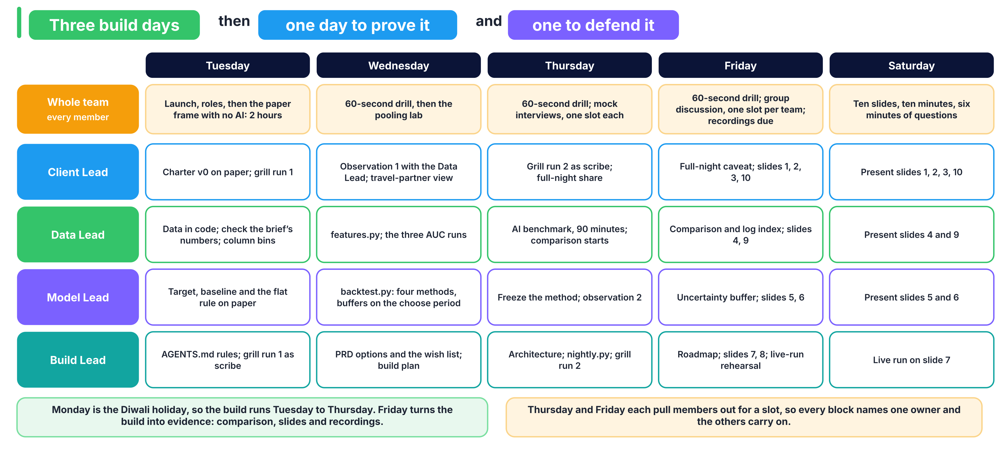

# How many rooms can each hotel oversell tonight?

<picture>
  <source media="(prefers-color-scheme: dark)" srcset="docs/assets/svg/animated/01-hero-dark.svg">
  
</picture>

Build 2, Week 6. We are a revenue-science squad answering one question from a two-hotel group in Portugal (`BRIEF.md`): for each arrival night, how many rooms beyond capacity can each hotel keep selling, so that cancellations stop leaving rooms empty, without walking more than 10 guests per 1,000 arrivals.

The answer is judged in euros, rooms and walked guests by the client's own scoring rule, `src/contract.py`. Accuracy is not the measure.

> **Where this stands.** The data checks and the choose-period results below are real and reproducible. The January to August 2017 proof run is **sealed**: it is run once, after the team freezes its choices, and no 2017 figure appears on this page.

## Contents

1. [The problem](#1-the-problem)
2. [The system in five steps](#2-the-system-in-five-steps)
3. [The data](#3-the-data)
4. [Preparation and features](#4-preparation-and-features)
5. [What the data shows](#5-what-the-data-shows)
6. [Training and selection](#6-training-and-selection)
7. [Is the probability any good?](#7-is-the-probability-any-good)
8. [Choosing the buffer](#8-choosing-the-buffer)
9. [Three rules, one contract](#9-three-rules-one-contract)
10. [One night, worked through](#10-one-night-worked-through)
11. [Where the project stands](#11-where-the-project-stands)
12. [Run it](#12-run-it)
13. [Where every number comes from](#13-where-every-number-comes-from)
14. [Team workspace](#14-team-workspace)

## 1. The problem

<picture>
  <source media="(prefers-color-scheme: dark)" srcset="docs/assets/svg/animated/02-problem-dark.svg">
  
</picture>

A hotel that sells exactly its capacity loses a room every time a booking cancels. A hotel that oversells too far has to walk an arriving guest to another hotel. The contract prices both mistakes for each hotel-night:

| Mistake | Count | Cost |
|---|---|---|
| Too few extra rooms sold | empty rooms = max(_A_ − _k_, 0) | the night's average booked stay value (`adr` × nights) per room |
| Too many extra rooms sold | walked guests = max(_k_ − _A_, 0) | €300 per guest |

_A_ is the number of that night's bookings that cancelled; _k_ is the oversell count we choose in advance. On top of the cost, a rule is rejected outright if it walks more than 10 guests per 1,000 arrivals over the whole period.

## 2. The system in five steps

<picture>
  <source media="(prefers-color-scheme: dark)" srcset="docs/assets/svg/animated/03-pipeline-dark.svg">
  
</picture>

The decision rule is one line:

```text
k = max(0, floor(expected − z × spread))
```

`expected` is the sum of the night's cancellation probabilities, `spread` is the standard deviation of that sum if bookings cancel independently, and `z` is the safety setting. `split_periods`, `nightly_table` and `night_cost` come from `src/contract.py` and are used unchanged.

## 3. The data

<picture>
  <source media="(prefers-color-scheme: dark)" srcset="docs/assets/svg/animated/04-data-dark.svg">
  
</picture>

119,390 bookings and 32 columns, arrivals from 1 July 2015 to 31 August 2017: 79,330 at the City Hotel and 40,060 at the Resort Hotel. 44,224 bookings were cancelled, which is 37.04%, not the "one in four" the brief estimated.

The split is by arrival date, never random:

| Period | Arrival dates | Bookings | Used for |
|---|---|---:|---|
| Train | before 1 July 2016 | 49,157 | fitting the model and the flat rule's cancellation rates |
| Choose | 1 July to 31 December 2016 | 29,546 | choosing `z` and the flat-rule allowance under the ceiling |
| Proof | 1 January to 31 August 2017 | 40,687 | one scoring run at the end |

## 4. Preparation and features

<picture>
  <source media="(prefers-color-scheme: dark)" srcset="docs/assets/svg/animated/05-preprocessing-dark.svg">
  
</picture>

- **Nothing is deleted.** 16,291 repeated rows stay, because there is no booking ID to prove they are duplicates. 1,085 train bookings carry a quality flag (zero guests, zero nights, zero or extreme price, very large parties, very long stays) and stay too.
- **Two fills.** Four missing `children` values become the train median, 0. Missing `country` becomes `Unknown`.
- **12 features, all known when the booking is made.** Six categorical, five numerical, one binary.
- **Left out on purpose.** `reservation_status` and its date leak the outcome. `deposit_type`, `booking_changes`, `assigned_room_type`, `country`, parking and special requests can change after booking. `days_in_waiting_list` depends on confirmation. `agent` and `company` are identifiers. `adr` and nights are kept for scoring only.
- **47 model inputs.** One-hot encoding for categories (unknown categories ignored), median fill and standard scaling for numbers. The preprocessing is fitted on the train period and reused unchanged afterwards.

## 5. What the data shows

All figures in this section are from the train period only.

<picture>
  <source media="(prefers-color-scheme: dark)" srcset="docs/assets/svg/animated/06-eda-lead-time-dark.svg">
  
</picture>

Cancellation climbs steadily with lead time at both hotels. Same-day bookings rarely cancel; City Hotel bookings made 181 or more days ahead cancel 76.2% of the time.

<picture>
  <source media="(prefers-color-scheme: dark)" srcset="docs/assets/svg/animated/07-eda-prepaid-segments-dark.svg">
  
</picture>

The brief's first observation ("prepaid means guaranteed") does not hold: 6,328 of 6,343 non-refundable City Hotel bookings were cancelled, and 1,093 of 1,151 at the Resort. Whether the hotel keeps the payment is a question for the client; the data does not say. By segment, Groups cancel most at both hotels.

Two more checks from the notebook:

- City Hotel cancels more than the Resort: 41.66% against 25.15%. These two rates are what the flat rule uses.
- Always guessing "not cancelled" is right 64.23% of the time on the train period, which is why accuracy alone says little here.

## 6. Training and selection

<picture>
  <source media="(prefers-color-scheme: dark)" srcset="docs/assets/svg/animated/08-training-workflow-dark.svg">
  
</picture>

One model: logistic regression (`max_iter=1000`, `random_state=42`) on the 47 prepared inputs, with no class weights and no resampling, so that the probabilities keep the natural 64 / 36 class mix. Logistic regression was chosen because the decision rule needs a probability per booking that can be summed per night, not a yes or no label.

On the choose period, 17 values of `z` (0 to 4 in steps of 0.25) and 31 flat-rule allowances (0 to 0.60 in steps of 0.02) are each scored with the contract. The cheapest setting that meets the walk ceiling is kept: **z = 3.25** for the ML rule and an allowance of **0.16** for the flat rule.

Not built in the notebook these graphics come from: the RFP also asks for a lookup-table method and a second learned model on the same hotel-nights. Nothing here claims they were tested.

## 7. Is the probability any good?

<picture>
  <source media="(prefers-color-scheme: dark)" srcset="docs/assets/svg/animated/09-evaluation-dark.svg">
  
</picture>

| Metric | Train | Choose | Reading |
|---|---:|---:|---|
| ROC-AUC | 0.815 | 0.709 | ranks better than chance, and noticeably worse on later dates |
| Brier score | 0.148 | 0.197 | a constant base-rate guess scores 0.233 on the choose period |
| Mean predicted cancellation | 35.8% | 34.7% | actual on the choose period was 36.9% |

Over the 368 choose-period hotel-nights the model expected 10,242 cancellations and 10,894 happened. The calibration curve is uneven in the middle: bookings given about 55% cancelled 41% of the time, and bookings given about 64% cancelled 76% of the time. The proof period has not been scored.

## 8. Choosing the buffer

<picture>
  <source media="(prefers-color-scheme: dark)" srcset="docs/assets/svg/animated/10-choosing-the-buffer-dark.svg">
  
</picture>

With no buffer the rule is cheapest (€1,043,759) but walks 58 guests per 1,000 arrivals. Cost rises with every step of `z`, so the choice is made by the ceiling: `z = 3.25` is the first value under 10, at 8.58 walks per 1,000.

## 9. Three rules, one contract

<picture>
  <source media="(prefers-color-scheme: dark)" srcset="docs/assets/svg/animated/11-rule-comparison-dark.svg">
  
</picture>

| Rule (choose period) | Cost | Empty rooms | Walked guests | Walks per 1,000 | Ceiling met |
|---|---:|---:|---:|---:|:---:|
| No oversell | €4,155,341 | 10,894 | 0 | 0.00 | yes |
| Flat rule, allowance 0.16 | €2,173,410 | 5,192 | 164 | 8.79 | yes |
| ML rule, z = 3.25 | €2,151,912 | 5,221 | 160 | 8.58 | yes |

The ML rule comes out €21,498 cheaper than the flat rule, about 1.0%. That margin is thin, and both buffers were tuned on these same nights, so this is a selection result and not proof. The 2017 run decides.

## 10. One night, worked through

<picture>
  <source media="(prefers-color-scheme: dark)" srcset="docs/assets/svg/animated/12-one-night-dark.svg">
  
</picture>

The morning table the revenue manager reads has one row per hotel and night. This is the validation-only version (14 nights from 18 December 2016), produced with the choose-period settings:

<details>
<summary>Show the 28 rows</summary>

| Hotel | Night | Bookings | Expected cancellations | Buffer (z × spread) | Oversell k |
|---|---|---:|---:|---:|---:|
| City Hotel | 2016-12-18 | 47 | 15.2 | 10.1 | 5 |
| Resort Hotel | 2016-12-18 | 16 | 3.1 | 5.2 | 0 |
| City Hotel | 2016-12-19 | 57 | 14.0 | 10.1 | 3 |
| Resort Hotel | 2016-12-19 | 42 | 7.2 | 7.5 | 0 |
| City Hotel | 2016-12-20 | 42 | 11.7 | 9.1 | 2 |
| Resort Hotel | 2016-12-20 | 36 | 8.7 | 7.5 | 1 |
| City Hotel | 2016-12-21 | 58 | 16.3 | 10.4 | 5 |
| Resort Hotel | 2016-12-21 | 31 | 5.7 | 6.8 | 0 |
| City Hotel | 2016-12-22 | 72 | 33.8 | 11.4 | 22 |
| Resort Hotel | 2016-12-22 | 53 | 11.7 | 9.4 | 2 |
| City Hotel | 2016-12-23 | 63 | 24.3 | 12.0 | 12 |
| Resort Hotel | 2016-12-23 | 64 | 10.6 | 9.1 | 1 |
| City Hotel | 2016-12-24 | 60 | 21.8 | 11.7 | 10 |
| Resort Hotel | 2016-12-24 | 64 | 12.2 | 9.8 | 2 |
| City Hotel | 2016-12-25 | 51 | 19.4 | 10.7 | 8 |
| Resort Hotel | 2016-12-25 | 21 | 4.4 | 5.9 | 0 |
| City Hotel | 2016-12-26 | 114 | 45.7 | 16.2 | 29 |
| Resort Hotel | 2016-12-26 | 50 | 10.2 | 8.8 | 1 |
| City Hotel | 2016-12-27 | 176 | 48.1 | 17.6 | 30 |
| Resort Hotel | 2016-12-27 | 39 | 5.1 | 6.5 | 0 |
| City Hotel | 2016-12-28 | 115 | 49.5 | 15.9 | 33 |
| Resort Hotel | 2016-12-28 | 34 | 5.8 | 6.8 | 0 |
| City Hotel | 2016-12-29 | 130 | 56.8 | 15.9 | 40 |
| Resort Hotel | 2016-12-29 | 33 | 6.1 | 6.8 | 0 |
| City Hotel | 2016-12-30 | 104 | 35.8 | 14.6 | 21 |
| Resort Hotel | 2016-12-30 | 134 | 26.9 | 14.3 | 12 |
| City Hotel | 2016-12-31 | 45 | 17.3 | 10.1 | 7 |
| Resort Hotel | 2016-12-31 | 31 | 5.7 | 6.5 | 0 |

</details>

## 11. Where the project stands

<picture>
  <source media="(prefers-color-scheme: dark)" srcset="docs/assets/svg/animated/13-results-dark.svg">
  
</picture>

**Limits to state before anyone uses k as a live selling limit**

- The data has no room inventory, so `k` counts rooms beyond the night's bookings, not beyond real capacity.
- The contract scores each night's final book. Fourteen days out, a live night is still filling, so its `k` is provisional.
- Summing probabilities assumes bookings cancel independently. Groups do not.
- The walk ceiling is an average over the period. A single night can still walk guests.
- Cancellation behaviour in 2017 may differ from 2015 and 2016.

## 12. Run it

```bash
python src/backtest.py
python src/nightly.py --from 2017-08-18 --nights 14
```

During development, `python src/backtest.py` runs training and validation only and saves the validation-selected policy to `models/`. Proof is explicitly gated: use `python src/backtest.py --proof` only after the team freezes its choices. The August nightly command above is also reserved for the final demonstration; neither was run during this refactor. `pytest -q` checks the scoring contract and saved-policy inference using validation dates.

For a validation-only nightly check, use:

```bash
python src/nightly.py --from 2016-12-18 --nights 14 --output evidence/validation_nightly_k.csv
```

The notebooks are split into data preparation, model training and final proof. Run them in that order, and leave the final-proof notebook until the team has frozen its choices.

## 13. Where every number comes from

| Figures | Source |
|---|---|
| Dataset size, split sizes, cancellation rates, lead time, deposit type, market segment, data-quality counts, feature list | Printed outputs stored in the project notebook |
| ROC-AUC, Brier, calibration, the z and allowance grids, the three-rule comparison, the worked night, the 14-night table | `docs/assets/build/run_model.py`: the notebook's modelling cells re-run on the train and choose periods only (scikit-learn 1.9.1), saved in `docs/assets/build/results.json` |
| €300 walk cost, ceiling of 10 per 1,000 | `src/contract.py`, as set by the course brief |
| 2017 proof figures | none on this page |

The graphics are generated from those two sources by `docs/assets/build/`; see `docs/assets/README.md` for the full asset library (animated SVG, PNG, GIF, MP4 and a slide deck) and for how to fill in the proof result after the single proof run.

## 14. Team workspace

Everything the team builds, decides and records lives in this repository. The last commit before Friday's deadline is the one that is graded.



### What do we open, and when?

| When                        | Open                                                                                                                                      | Why                                                        |
| --------------------------- | ----------------------------------------------------------------------------------------------------------------------------------------- | ---------------------------------------------------------- |
| Tuesday, first hour         | `BRIEF.md` in full, `docs/ROLES.md` (your row and the disagreement rule), `docs/LADDER.md` (stages 0 to 2), `docs/EVALUATION_CONTRACT.md` | The ask, your role, the stages and the scoring rule        |
| Tuesday, paper frame, no AI | `docs/CHARTER.md`, `docs/RFP.md`, `docs/DOMAIN.md`                                                                                        | Ladder stages 0 to 2                                       |
| Tuesday, data               | `notebooks/00_start_here.ipynb`, `docs/COLUMNS.md`, `docs/DECISIONS.md`                                                                   | Check the brief's numbers and start the column audit       |
| Tuesday, grill run 1        | `docs/AI_WORKFLOW.md`, `AGENTS.md`                                                                                                        | Agent rules and the first grilling                         |
| Wednesday                   | `docs/PRD.md`, `docs/BUILD_PLAN.md`, `src/contract.py`                                                                                    | Options, then the POC method table                         |
| Thursday                    | `docs/AI_WORKFLOW.md`, `ai_benchmark/README.md`                                                                                           | The MVP, the AI benchmark and grill run 2                  |
| Friday                      | `docs/COMPARISON.md`, `docs/ROADMAP.md`, `docs/PRESENTATION.md`, `docs/RECORDING.md`                                                      | The comparison, the roadmap, the slides and your recording |
| Any time                    | `docs/RUBRIC.md`                                                                                                                          | How the 40 marks are given                                 |

### Who owns each artifact, and who has signed it?

A challenger signs by writing the commit hash they checked. An artifact counts as done only once it is signed.

| Artifact                                                 | Owner            | Challenger       | Signed at commit |
| -------------------------------------------------------- | ---------------- | ---------------- | ---------------- |
| `docs/CHARTER.md` and `docs/RFP.md`                      | Kunal Pidiha     | Nitya            |                  |
| `docs/COLUMNS.md` and `src/features.py`                  | Diksha           | Mohit Pasupuleti |                  |
| `src/backtest.py`                                        | Nitya            | Kunal Pidiha     |                  |
| `docs/PRD.md`, `docs/BUILD_PLAN.md` and `src/nightly.py` | Mohit Pasupuleti | Diksha           |                  |
| `docs/COMPARISON.md`                                     | Diksha           | Mohit Pasupuleti |                  |

### Where are our recordings?

| Member           | Role        | Recording link on the LMS |
| ---------------- | ----------- | ------------------------- |
| Kunal Pidiha     | Client Lead |                           |
| Diksha           | Data Lead   |                           |
| Nitya            | Model Lead  |                           |
| Mohit Pasupuleti | Build Lead  |                           |

### Where does the data come from?

Antonio, N., de Almeida, A. and Nunes, L. (2019). Hotel booking demand datasets. _Data in Brief_, 22, 41 to 49. CC BY 4.0. `src/data.py` downloads it; see `data/README.md`.
